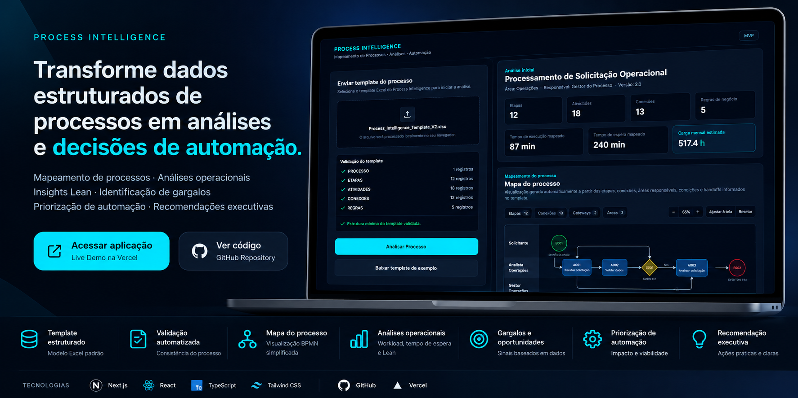

# Process Intelligence

**From structured process data to operational intelligence and automation decisions.**

Process Intelligence is a portfolio project that transforms structured operational data into process visualization, workload analytics, Lean insights, bottleneck signals, automation prioritization and executive recommendations.

### [Live Demo](https://process-intelligence-seven.vercel.app)

### [GitHub Repository](https://github.com/YuryBdS/process-intelligence)

---

## Why I Built This
